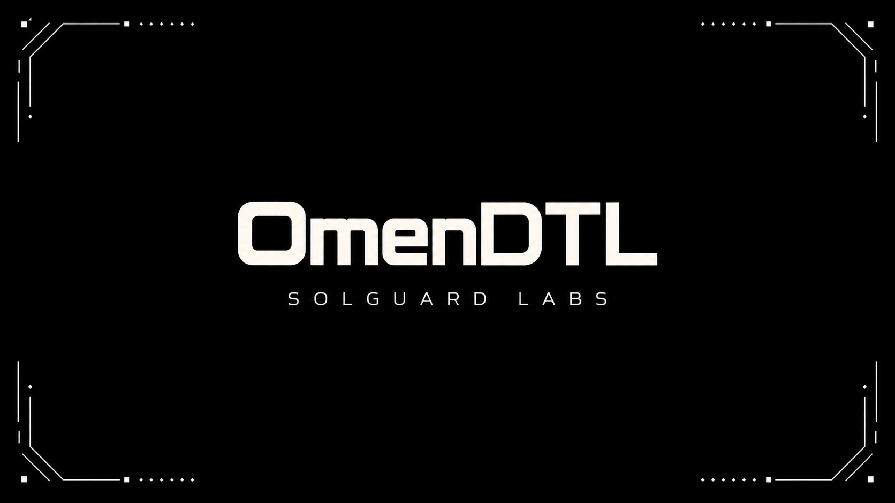
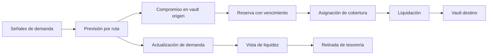

# OmenDTL



OmenDTL coordina liquidez entre vaults mediante previsiones de demanda,
reservas por ruta y liquidaciones diferidas. Su motor determinista está escrito
en Go; una CLI emite reportes JSON para operaciones, conciliación y análisis.
No necesita servicios externos para ejecutar los escenarios incluidos.

## Modelo operativo



El modelo distingue saldo líquido, compromiso de previsión, reserva asignada,
deuda de liquidación y buffer mínimo. Cada ruta enlaza vaults del mismo activo;
el importe de una reserva se expresa en unidades enteras del activo.

## Ejecución

Requisitos: Go 1.22+, Node.js 24+ y npm.

```bash
npm ci
npm run build
./out/omendtl --list
./out/omendtl scenario operator-day > report.json
npm run inspect -- report.json ousdc
./out/omendtl validate operator-day
```

En Windows, use `./out/omendtl.exe`. El ejemplo `operator-day` recorre apertura de
ventana, asignación, actualización y liquidación. El inspector agrupa posiciones
del activo elegido y calcula cobertura agregada; no modifica el ledger.

## Cálculo económico

Para cada vault, la capacidad operativa observada se calcula como:

```text
reserva_líquida = max(0, reserva + entradas_pendientes - salidas_pendientes)
bloqueado = previsión_comprometida + reserva_asignada
          + deuda_de_liquidación + buffer_mínimo
liquidez_libre = max(0, reserva_líquida - bloqueado)
```

Las señales se ponderan por confianza y política de ruta antes de aplicar el
haircut del activo. El settlement transforma una reserva vencida en deuda,
debita el vault origen y acredita al destino el importe neto de comisión.
Consulte [el modelo económico](./docs/modelo-economico.md) para unidades,
redondeos y un ejemplo numérico.

## Contrato de reporte

La CLI publica `protocol`, `scenario`, `network_id`, `clock` y `state_digest`,
además de `vaults`, `routes`, `forecasts`, `reservations`, `settlements`,
`demand_updates`, `withdrawals`, `risk` e `invariants`. El digest permite
comparar estados completos de la misma revisión; no sustituye la conciliación
de importes ni identifica una transacción externa.

El cliente `client/report-client.ts` valida importes enteros seguros y resume
por activo `reserve`, `freeLiquidity`, `exposure`, `minBuffer`,
`aggregateCoverageBps` y `freeShareBps`. Un resultado `null` en la cobertura
indica exposición agregada cero, no un cociente infinito.

## Verificación y estructura

```bash
npm run ci
```

La verificación ejecuta formato Go/Markdown/TypeScript, `go vet`, `go test`,
compilación y pruebas de integración Node. CI repite la secuencia en Ubuntu y
Windows. El repositorio separa `src/` (motor), `client/` (lectura de reportes),
`scripts/` (build e inspección), `tests/` (contratos) y `docs/` (operación).

- [Arquitectura y flujos](./docs/arquitectura.md)
- [Modelo económico](./docs/modelo-economico.md)
- [Operación y conciliación](./docs/operacion.md)
- [Seguridad](./SECURITY.md)

La rama `production` y el tag `v1.0.0` identifican la misma revisión que
`main` en la release `Production 1.0.0`.
