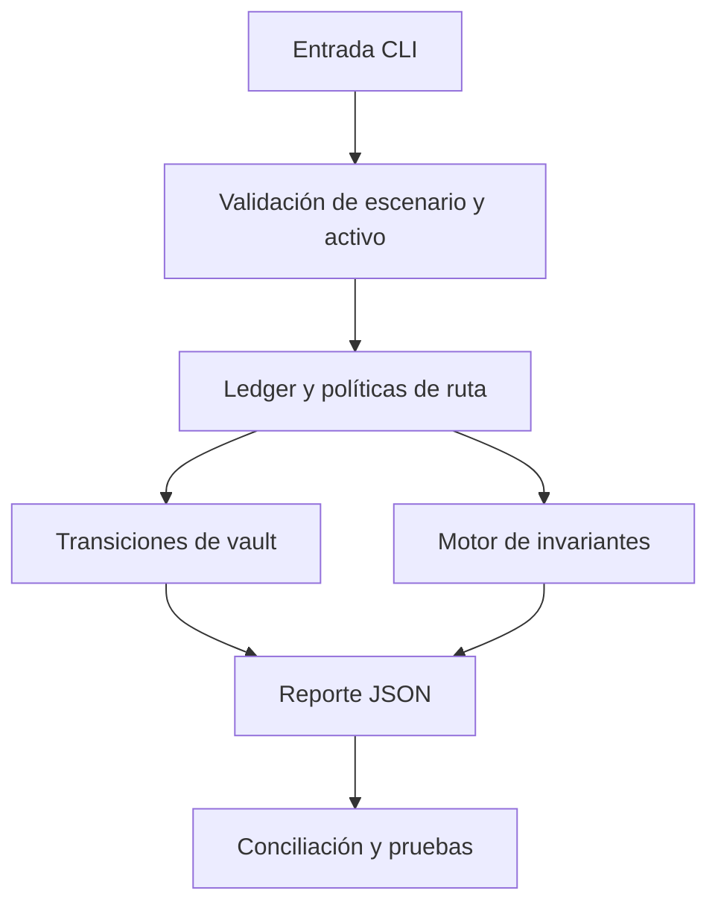

# Seguridad de OmenDTL

## Superficies y límites

El motor recibe señales de demanda y solicitudes de reserva asociadas a rutas
registradas. El ledger mantiene activos, cuentas, vaults, ciclos y estados de
liquidación en una ejecución determinista. La CLI y el cliente de reportes son
interfaces locales; no gestionan claves ni firman transacciones.

## Controles comprobables

Las cantidades se representan como enteros; los importes negativos se rechazan
en operaciones de vault. Las rutas requieren vaults existentes y activos
coincidentes. El motor limita reservas por política, exige ventanas de ciclo
abiertas y valida enlaces entre previsión, reserva y settlement. Los retiros
comprueban la liquidez libre observada en el instante de ejecución.

El reporte publica indicadores de consistencia para balances no negativos,
enlaces válidos y contabilidad de previsión. Un indicador positivo acredita
solo la condición que expresa; no reemplaza pruebas de secuencias completas
ni conciliación externa.

## Revisión de cambios

1. Ejecutar `npm run ci` en una rama aislada.
2. Comparar el `state_digest` y los importes por activo de escenarios estables.
3. Revisar cambios de políticas, unidades, redondeos y orden temporal.
4. Confirmar CI en PR, `main`, `production`, tag y release.

Los reportes técnicos deben indicar revisión, comando, escenario, estado
inicial, transición observada, importes y expectativa. No incluir secretos,
credenciales ni datos de terceros en issues públicos. Consulte
[operación](./docs/operacion.md) para la conciliación diaria.
