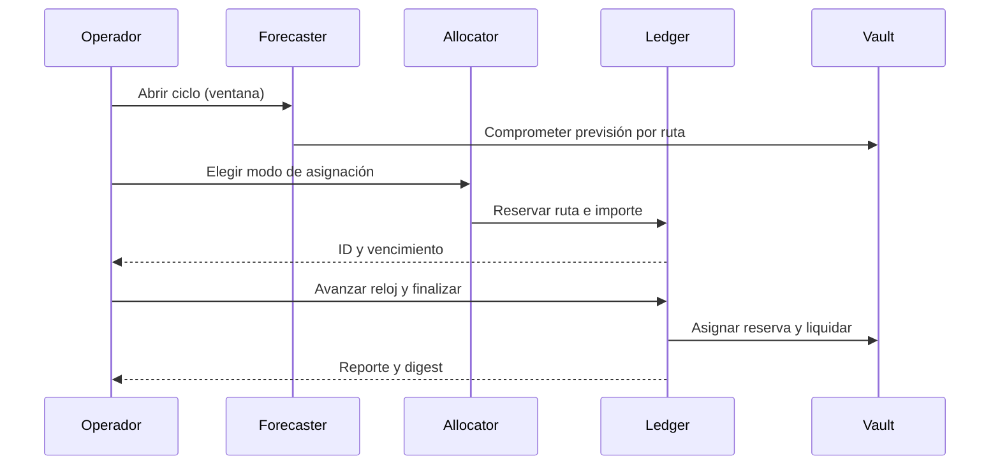

# Arquitectura y ciclo de OmenDTL

## Responsabilidades

`src/asset.go` define decimales, haircuts y comisión. `src/route.go` enlaza
origen, destino y política de demanda. `src/forecast.go` construye las
previsiones de ciclo; `src/allocator.go` propone reservas; `src/ledger.go`
coordina transiciones y eventos. `src/vault.go` contabiliza capacidad, mientras
`src/settlement.go` describe el estado de una liquidación. `src/report.go`
exporta una vista ordenada y `src/codec.go` calcula su digest.

Los escenarios son deterministas: mismo código, semilla y orden de operaciones
producen el mismo reporte. `Clock` es un contador lógico, no tiempo de bloque.
Los IDs derivan del contexto y los reportes ordenan las entidades antes de
serializarlas. El digest se calcula sobre campos económicos seleccionados; no
incluye notas narrativas.

## Estados

Una previsión pasa por `open`, `reserved`, `settling` y `closed`. La reserva
puede estar `queued`, `bound`, `settling`, `completed`, `failed` o `cancelled`.
La liquidación termina `finalized`, `frozen` o `rejected` según los enlaces y
la capacidad disponible en la operación. Son estados distintos: una reserva
creada aún no equivale a dinero transferido.

El reporte distingue el estado final de cada entidad del registro de eventos;
para analizar una ejecución debe leerse ambos. Los campos `route`, `asset`,
`source_vault` y `target_vault` permiten correlacionar registros sin depender
de la posición de los arrays.
