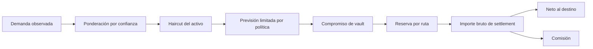

# Modelo económico

## Unidades y redondeos

Los importes son enteros en la unidad mínima declarada por el activo. Un
importe `1_000_000` de `ousdc` con seis decimales representa una unidad. Las
políticas usan puntos básicos: `10_000 bps = 100 %`. Las multiplicaciones de
previsión y haircut usan redondeo entero definido por `Amount`; ningún cliente
debe introducir floats para enviar importes al motor.

## Capacidad y exposición

Para un vault, `Exposure()` agrega compromiso de previsión, reservas asignadas,
deuda de settlement y salidas pendientes. La ratio `CoverageRatioBps()` compara
reserva con esa exposición. `FreeLiquidity()` descuenta además el buffer mínimo
y tiene suelo cero. Son métricas de momentos distintos: una ratio alta no
autoriza por sí sola una retirada.

Ejemplo ilustrativo, en unidades mínimas de un mismo activo:

| Concepto                 |   Importe |
| ------------------------ | --------: |
| Reserva                  | 5 000 000 |
| Previsión comprometida   |   900 000 |
| Reserva ya asignada      |   300 000 |
| Deuda de settlement      |   200 000 |
| Buffer mínimo            |   250 000 |
| Liquidez libre calculada | 3 350 000 |

El cálculo es `5 000 000 - 900 000 - 300 000 - 200 000 - 250 000`.
Si hay salidas pendientes se descuentan antes; si hay entradas pendientes se
incluyen en la reserva líquida observada. La comisión se resta del importe
bruto recibido por el destino durante la liquidación.

## Resumen agregado del cliente

`summarizeReport` agrupa vaults del mismo activo. Suma reserva y exposición
antes de dividir, para evitar promediar ratios individuales con pesos
incorrectos. `aggregateCoverageBps = floor(10_000 × Σreserva / Σexposición)`;
si la exposición es cero devuelve `null`. La participación libre usa
`floor(10_000 × Σliquidez_libre / Σreserva)`. El resumen es observacional:
las decisiones operativas se toman con las políticas y transiciones del motor.
